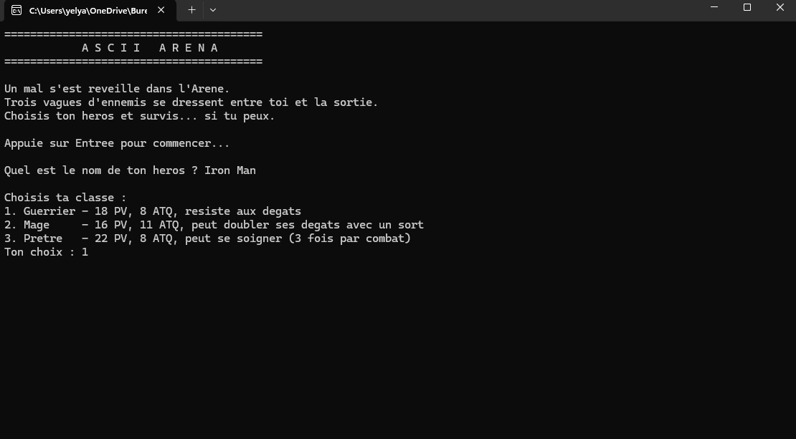

# ⚔️ ASCII Arena

Un jeu de combat au tour par tour, jouable dans le terminal. Choisis un héros, affronte 3 vagues d'ennemis, survis à l'Arène.

## Comment jouer

1. Lance le programme, donne un nom à ton héros
2. Choisis sa classe
3. À chaque tour de combat : attaque, utilise ta capacité spéciale, ou abandonne
4. Bats les 3 vagues d'ennemis pour gagner

| Classe | PV | ATQ | Capacité spéciale |
|---|---|---|---|
| Guerrier | 18 | 8 | Résiste aux dégâts (-2 sur chaque coup reçu) |
| Mage | 16 | 11 | Sort qui double les dégâts du prochain coup (coûte 3 PV) |
| Prêtre | 22 | 8 | Se soigne de 8 PV (3 fois par combat max) |

Le héros récupère toute sa santé entre chaque vague. Les ennemis ont le même comportement que les héros de leur classe (le Mage ennemi lance des sorts, le Prêtre ennemi se soigne).

## Concepts C++

Héritage et polymorphisme (`virtual` / `override`), `shared_ptr` pour le héros, pointeurs bruts (`new`/`delete`) pour les ennemis, `static_pointer_cast` pour accéder aux capacités propres à chaque classe.

## Auteur

**Yassine El Yazami** — Étudiant en Automatisation (EPHEC TECH)